# 📋 Master Dokumentasi Sistem, Arsitektur, Hasil Akhir & Panduan Deployment NETORA v2

---

## 🌐 Informasi Live Production Proyek

| Parameter | Detail Konfigurasi Produksi |
|---|---|
| **Nama Aplikasi** | **NETORA v2 — Portal Pembelajaran TKJ** |
| **URL Domain Resmi (HTTPS)** | 👉 **`https://netora.web.id`** & **`https://www.netora.web.id`** (ONLINE & AKTIF) |
| **URL Server Pterodactyl Asli** | `http://163.52.135.155:2974` |
| **Panel Hosting** | FinCloud Pterodactyl (`https://panel.fincloud.my.id/server/1f5ca09c`) |
| **Node IP Server** | `163.52.135.155` |
| **Port Alokasi Pterodactyl** | **`2974`** |
| **Registrar Domain** | DomaiNesia (Status: Active, Registrar Lock: Disabled) |
| **DNS & CDN Provider** | Cloudflare Free Plan |
| **Cloudflare Nameservers** | `fattouche.ns.cloudflare.com` & `lorna.ns.cloudflare.com` |
| **Mode SSL / Enkripsi** | Cloudflare Flexible + Always Use HTTPS + Auto HTTPS Rewrites |
| **Port Forwarding Rule** | Cloudflare Origin Rule (`port-netora`: Rewrite 443 $\rightarrow$ Destination Port `2974`) |
| **Cloud Database** | **Supabase Cloud (PostgreSQL)** — Terhubung Sukses |
| **Repository Git Resmi** | `https://github.com/netoraid/netora-project` |
| **Format Aplikasi Mobile** | Progressive Web App (PWA) & APK Ready via PWABuilder |

---

## 🚀 1. Overview & Visi Proyek

**NETORA v2** adalah platform aplikasi web pembelajaran interaktif terpadu untuk jurusan **Teknik Komputer dan Jaringan (TKJ)** berbasis *full-stack*. Aplikasi ini dirancang dengan antarmuka futuristik bertema **Dark Cyberpunk & Clean Modern** yang mengusung prinsip **Native Web App (Single Page Application Transition)** dan **Responsif Penuh**:
- **Desktop View ($\ge$ 992px)**: Tampil sebagai **Dashboard Pembelajaran Modern** yang leluasa (lebar maksimal 1180px) dengan tata letak multi-kolom simetris, header navigasi desktop, modul materi unggulan, dan laboratorium tugas siswa interaktif.
- **Mobile View ($<$ 992px)**: Tampil ringkas, bersih, ramah jempol (*mobile-first*), tanpa batasan bingkai ponsel tiruan yang membatasi layar fisik smartphone, dilengkapi *Bottom Navigation Bar* putih bersih dan gestur *Pull-to-Refresh*.

---

## 🛠️ 2. Tech Stack & Arsitektur Sistem

Aplikasi dibangun dengan teknologi yang ringan, cepat, tanpa overhead framework berat (*Vanilla Architecture*), sehingga memiliki portabilitas 100% di berbagai platform hosting dan container:

### A. Frontend (Klien)
- **HTML5 Semantik**: Struktur dokumen bersih, teroptimasi SEO, meta tag viewport mobile responsif, dan favicon terpasang di seluruh halaman.
- **Vanilla CSS3 (Design System Terpadu)**: 
  - Variabel CSS (`:root`), Flexbox, CSS Grid.
  - Efek visual modern: Glassmorphism, Ambient Glow, Keyframe Animation 60 FPS.
  - Dual Mode Visual: Cyberpunk Dark Mode & Clean White Card Layout.
- **Vanilla JavaScript ES6+**:
  - **Native SPA Transition Router**: Pergantian halaman instan tanpa reload dokumen, bebas layar putih (*zero-white-flash*).
  - **In-Memory Pre-Caching**: Memuat halaman di RAM browser untuk respon instan < 10ms.
  - **Dynamic State & DOM Manipulation**: Event binding otomatis, Async/Await Fetch API, Modal System, Toast Notification Engine.
- **Progressive Web App (PWA)**:
  - `manifest.json` terpasang untuk instalasi di Android/iOS (*standalone mode*).
  - `sw.js` (Service Worker) terdaftar untuk caching dan performa cepat.

### B. Backend (Server)
- **Node.js (v24+)**: Runtime JavaScript asynchronous berkinerja tinggi.
- **Express.js (v4.21+)**: Web application framework untuk routing RESTful API dan penyajian file statis.
- **Session Management (`express-session`)**: Pengelolaan autentikasi berbasis cookie `httpOnly` dengan masa aktif 24 jam dan dukungan reverse proxy (`app.set('trust proxy', 1)`).
- **Keamanan Sandi (`bcryptjs`)**: Password hashing dengan algoritma salt 10 rounds (100% Pure JavaScript, tanpa kompilasi native C++).
- **File Upload Engine (`multer`)**: Pengunggahan foto profil avatar ke direktori `public/uploads/` dengan filter ekstensi gambar dan batasan ukuran berkas (maks 5MB).
- **Komunikasi Real-Time (`Socket.IO` v4.8+)**: Engine WebSocket dua arah (bidirectional) untuk sinkronisasi aktivitas real-time: live online counter, notifikasi kuis instan, pembaruan leaderboard, broadcast materi & pengumuman tanpa reload.
- **CORS & Body Parser**: Terintegrasi untuk mendukung integrasi API lintas perangkat.

### C. Basis Data (Database)
- **Engine**: **Supabase Cloud (PostgreSQL)**.
- **Client**: **`@supabase/supabase-js`** terintegrasi langsung dengan backend Express.js.
- **Kredensial**: Menggunakan `SUPABASE_SERVICE_ROLE_KEY` untuk operasi backend penuh dan RLS (*Row Level Security*) pada tabel publik.
- **Fitur Utama**: Skalabilitas cloud, relasi integritas referensial penuh (Foreign Key `ON DELETE CASCADE`), indeks performa tinggi, dan backup cloud otomatis.

---

## 📁 3. Struktur File & Direktori Proyek

```
Netora/
├── server.js                  # Entrypoint server Express & port binding dinamis (SERVER_PORT)
├── package.json               # Konfigurasi dependensi Pure JS & engines Node.js
├── package-lock.json          # Lockfile dependensi npm
├── planing.md                 # Master dokumentasi sistem, arsitektur, dan panduan deploy
├── .env                       # File konfigurasi rahasia Supabase & Port (terlindungi .gitignore)
├── .env.example               # Template variabel lingkungan untuk server/deploy
├── .gitignore                 # Filter berkas keamanan (node_modules, .env, *.mp4, *.apk)
├── logo.png                   # Master logo Netora
│
├── database/
│   ├── init.js                # Wrapper query kompatibilitas aplikasi
│   ├── supabase.js            # Inisialisasi Supabase Client & verifikasi koneksi cloud
│   └── supabase_schema.sql    # DDL skema 6 tabel PostgreSQL Supabase + initial data seed
│
├── middleware/
│   └── auth.js                # Middleware proteksi route session (requireAuth, requireGuru, admin check)
│
├── routes/
│   ├── auth.js                # Endpoint Login, Register, Logout, & Session Me (Multi-Role: Siswa/Guru/Admin)
│   ├── materi.js              # Endpoint Katalog & Detail Modul Materi
│   ├── video.js               # Endpoint Galeri Video Praktikum Mikrotik
│   ├── quiz.js                # Endpoint Soal Quiz & Perhitungan Skor
│   ├── pengumuman.js          # Endpoint Pengumuman & Notifikasi
│   ├── profil.js              # Endpoint Profil, Password, Avatar, & Hapus Akun Siswa
│   ├── admin.js               # Endpoint CRUD Lengkap Khusus Admin
│   └── guru.js                # Endpoint Khusus Dashboard Guru (Nilai Quiz, Progress %, CRUD Soal)
│
├── services/
│   └── socket.js              # Service WebSocket Socket.IO (Live Online, Quiz/Materi/Pengumuman Broadcast)
│
└── public/                    # Seluruh Halaman & Aset Web (Static Web Root)
    ├── manifest.json          # Manifest PWA (Nama aplikasi, warna tema, logo)
    ├── sw.js                  # Service Worker PWA (Cache fallback)
    ├── assets/
    │   ├── logo.png           # Logo master Netora
    │   ├── banner1.jpg        # Banner ilustrasi materi
    │   └── banner2.jpg        # Banner ilustrasi praktikum
    ├── uploads/
    │   └── default.png        # Avatar default pengguna & folder unggahan foto
    ├── css/
    │   └── netora.css         # Master Stylesheet (Desktop, Mobile, Animasi SPA, Layout, Profil, Progres)
    ├── js/
    │   ├── netora.js          # Engine SPA Router (Anti-freeze, Sync <style>, Bypass Guru/Admin)
    │   ├── auth.js            # Logika Login, Register, Multi-Role Redirect (Siswa/Guru/Admin)
    │   ├── beranda.js         # Inisialisasi Beranda, Quick Menu & Carousel Banner
    │   ├── materi.js          # Inisialisasi & Filter Katalog Materi
    │   ├── video.js           # Inisialisasi Galeri & Video Player Modal
    │   ├── quiz.js            # State Machine Kuis Interaktif (Bebas ghost card saat kosong)
    │   ├── kalkulator.js      # Algoritma Subnetting RFC 791/4632 & Riwayat Lokal
    │   ├── progres.js         # Statistik Pembelajaran, Capaian Radar, & Riwayat Nilai
    │   ├── pengumuman.js      # Daftar Notifikasi & Pengumuman
    │   ├── profil.js          # Tab Edit Profil, Keamanan, Ganti Avatar, & Hapus Akun
    │   ├── admin.js           # Single Page Application Dashboard Admin
    │   └── guru.js            # Single Page Application Dashboard Guru (Nilai, Progres %, CRUD Quiz)
    │
    ├── beranda.html           # Dashboard Utama Siswa (4 Modul Inti & Lab Tugas)
    ├── materi.html            # Katalog Modul Pembelajaran (Grid 2 Kolom)
    ├── materi-detail.html     # Pembaca Modul Lengkap
    ├── video.html             # Galeri Video Praktik RouterOS
    ├── quiz.html              # Uji Kompetensi Interaktif
    ├── kalkulator.html        # Kalkulator Subnetting & CIDR Split Desktop
    ├── progres.html           # Laporan Capaian Belajar Siswa
    ├── pengumuman.html        # Pusat Pengumuman & Informasi
    ├── profil.html            # Profil Pengguna & Pengaturan Akun
    ├── login.html             # Halaman Masuk Multi-Role (Siswa, Guru, Admin)
    ├── register.html          # Halaman Pendaftaran Siswa
    ├── admin.html             # Panel Kontrol Manajemen Admin
    ├── guru.html              # Panel Kontrol Manajemen Guru (EdTech Modern UI)
    └── tentang.html           # Informasi Versi Aplikasi & Pengembang
```

---

## 🗄️ 4. Skema Basis Data Supabase Cloud (PostgreSQL)

Telah termigrasi 100% dari SQLite lokal ke **Supabase PostgreSQL** dengan DDL pada file `database/supabase_schema.sql`:

1. **`users`**:
   - `id` (SERIAL PRIMARY KEY)
   - `nama` (VARCHAR 255), `email` (VARCHAR 255 UNIQUE), `password` (VARCHAR 255 HASH BCRYPT)
   - `foto` (TEXT, default: `uploads/default.png`), `bio` (TEXT)
   - `role` (VARCHAR 50, default: `'siswa'`, opsi: `'siswa'`, `'guru'`, `'admin'`)
   - `created_at` (TIMESTAMP WITH TIME ZONE DEFAULT NOW())
2. **`materi`**:
   - `id` (SERIAL PRIMARY KEY), `judul` (VARCHAR 255), `kategori` (VARCHAR 100), `isi` (TEXT), `created_at` (TIMESTAMPTZ)
   - *(Kategori: Cisco, Mikrotik, Server & Linux, Jaringan Dasar)*
3. **`video`**:
   - `id` (SERIAL PRIMARY KEY), `judul` (VARCHAR 255), `deskripsi` (TEXT), `url_youtube` (TEXT)
   - `kategori` (VARCHAR 100), `durasi` (VARCHAR 50), `created_at` (TIMESTAMPTZ)
4. **`quiz`**:
   - `id` (SERIAL PRIMARY KEY), `pertanyaan` (TEXT)
   - `pilihan_a` (TEXT), `pilihan_b` (TEXT), `pilihan_c` (TEXT), `pilihan_d` (TEXT)
   - `jawaban_benar` (VARCHAR 10), `kategori` (VARCHAR 100), `created_at` (TIMESTAMPTZ)
5. **`nilai_quiz`**:
   - `id` (SERIAL PRIMARY KEY), `user_id` (INTEGER REFERENCES users(id) ON DELETE CASCADE)
   - `skor` (INTEGER), `tanggal` (TIMESTAMPTZ DEFAULT NOW())
6. **`pengumuman`**:
   - `id` (SERIAL PRIMARY KEY), `judul` (VARCHAR 255), `isi` (TEXT), `kategori` (VARCHAR 100)
   - `penting` (BOOLEAN DEFAULT FALSE), `created_at` (TIMESTAMPTZ)

---

## 🔌 5. Daftar Endpoint RESTful API

### 🔐 Autentikasi (`/api/auth`)
- `POST /api/auth/register` : Mendaftarkan siswa baru.
- `POST /api/auth/login` : Masuk akun siswa / admin.
- `POST /api/auth/logout` : Menghapus session aktif.
- `GET /api/auth/me` : Mendeteksi session login saat ini.

### 📚 Modul Pembelajaran (`/api/materi`)
- `GET /api/materi` : Mengambil seluruh katalog materi.
- `GET /api/materi/:id` : Mengambil detail baca modul materi.

### 🎥 Video Tutorial (`/api/video`)
- `GET /api/video` : Mengambil daftar video tutorial YouTube.

### 📝 Kuis Interaktif (`/api/quiz`)
- `GET /api/quiz` : Mengambil daftar soal kuis aktif tanpa membocorkan kunci jawaban.
- `POST /api/quiz/submit` : Menghitung skor kuis & menyimpan nilai (jika login).
- `GET /api/quiz/riwayat` : Riwayat nilai ujian siswa yang login.

### 📢 Pengumuman (`/api/pengumuman`)
- `GET /api/pengumuman` : Mengambil pengumuman aktif.

### 👤 Profil & Akun Siswa (`/api/profil`)
- `GET /api/profil` : Data profil & riwayat belajar siswa.
- `PUT /api/profil/update` : Memperbarui nama dan bio.
- `PUT /api/profil/ganti-password` : Mengganti kata sandi.
- `POST /api/profil/upload-foto` : Mengunggah foto profil (Multipart Form).
- `DELETE /api/profil/hapus-foto` : Mereset foto profil ke default.
- `DELETE /api/profil/hapus-akun` : Menghapus akun siswa mandiri dengan validasi password.

### 🛡️ Manajemen Admin (`/api/admin`)
- `GET /api/admin/stats` : Statistik total siswa, materi, video, dan quiz.
- `GET /api/admin/aktivitas` : Log aktivitas siswa terkini.
- `GET /api/admin/siswa` : Daftar seluruh siswa.
- `POST /api/admin/siswa` : Menambahkan akun siswa baru secara manual.
- `PUT /api/admin/siswa/:id/password` : Reset kata sandi siswa.
- `DELETE /api/admin/siswa/:id` : Menghapus akun siswa.
- `POST /api/admin/reset-siswa` : Reset massal data siswa non-admin.
- CRUD Materi: `GET`, `POST`, `PUT`, `DELETE` ke `/api/admin/materi`.
- CRUD Video: `GET`, `POST`, `PUT`, `DELETE` ke `/api/admin/video`.
- CRUD Quiz: `GET`, `POST`, `PUT`, `DELETE` ke `/api/admin/quiz`.
- CRUD Pengumuman: `GET`, `POST`, `DELETE` ke `/api/admin/pengumuman`.

### 👨‍🏫 Panel Kontrol Guru (`/api/guru`)
- `GET /api/guru/stats` : Ringkasan statistik guru (total soal kuis dibuat, total siswa terdaftar, total kuis yang telah dikerjakan, dan rata-rata skor kelas).
- `GET /api/guru/nilai-quiz` : Log seluruh riwayat pengerjaan nilai quiz siswa (nama, email, tanggal, skor, status kelulusan KKM $\ge$ 70).
- `GET /api/guru/siswa-progres` : Kalkulasi persentase progres belajar siswa (%) berdasarkan riwayat penyelesaian quiz terhadap total materi kuis aktif, dilengkapi status badge (*Selesai*, *Sedang Belajar*, *Belum Mulai*).
- `GET /api/guru/quiz` : Mengambil daftar seluruh bank soal quiz yang dibuat guru / admin beserta kunci jawabannya.
- `POST /api/guru/quiz` : Membuat materi/soal quiz baru dengan 4 pilihan ganda (A/B/C/D) dan kunci jawaban.
- `PUT /api/guru/quiz/:id` : Memperbarui pertanyaan, opsi pilihan, kunci jawaban, atau kategori materi kuis.
- `DELETE /api/guru/quiz/:id` : Menghapus soal kuis dari sistem.

---

## 🧭 6. Alur Pengguna & Sistem Hak Akses (User Flow)

```mermaid
graph TD
    A["Pengunjung Mengakses URL ('https://netora.web.id')"] --> B{"Punya Sesi Login?"}
    B -->|Tidak| C["Halaman Login (login.html)"]
    B -->|Ya & Role Siswa| D["Dashboard Siswa (beranda.html)"]
    B -->|Ya & Role Guru| E["Dashboard Guru (guru.html)"]
    B -->|Ya & Role Admin| F["Panel Admin (admin.html)"]
    
    C -->|Klik Daftar| G["Halaman Register (register.html)"]
    C -->|Login Sukses| B
    
    subgraph Fitur_Siswa ["Portal Siswa"]
        D --> S1["Materi Pembelajaran (materi.html)"]
        D --> S2["Video Praktik (video.html)"]
        D --> S3["Quiz Interaktif (quiz.html)"]
        D --> S4["Kalkulator IP (kalkulator.html)"]
        D --> S5["Laporan Progress (progres.html)"]
        D --> S6["Pusat Notifikasi (pengumuman.html)"]
        D --> S7["Pengaturan Akun (profil.html)"]
    end

    subgraph Fitur_Guru ["Portal Guru (Akses Khusus & Terbatas)"]
        E --> G1["Nilai Hasil Quiz Siswa & Export CSV"]
        E --> G2["Persentase Progress Siswa (%)"]
        E --> G3["Pembuatan & Manajemen Materi Quizz (CRUD)"]
    end

    subgraph Fitur_Admin ["Portal Admin (Akses Penuh Master)"]
        F --> A1["Manajemen Akun Siswa (Tambah/Reset/Hapus)"]
        F --> A2["CRUD Seluruh Materi & Modul"]
        F --> A3["CRUD Video Praktikum"]
        F --> A4["CRUD Bank Soal Quiz"]
        F --> A5["Broadcast Pengumuman & Log Sistem"]
    end
```



---

## 🌐 7. Panduan Deployment Lengkap ke Pterodactyl Panel (FinCloud)

Server produksi Netora v2 berjalan di container **Pterodactyl Panel FinCloud** dengan spesifikasi:

### A. Data Alokasi & Server Node
- **URL Panel**: `https://panel.fincloud.my.id/server/1f5ca09c`
- **Server UUID**: `1f5ca09c-d28f-4aad-b877-1d5747d3305f`
- **Node IP**: `203.175.125.151`
- **Port Alokasi Pterodactyl**: **`2974`**
- **Environment**: FinCloud Node.js Environment (Node v24.14.1)

### B. Variabel Lingkungan (`.env`) pada Pterodactyl Files
Di File Manager Pterodactyl, buat/edit file `.env`:
```env
PORT=2974
SERVER_PORT=2974
SERVER_IP=203.175.125.151
SESSION_SECRET=netora_cyberpunk_secret_key_2026
SUPABASE_URL=https://dkzebtyoboqxojigyjnv.supabase.co
SUPABASE_SERVICE_ROLE_KEY=eyJhbGciOiJIUzI1NiIsInR5cCI6IkpXVCJ9...
```

### C. Mekanisme Dynamic Port Binding di `server.js`
Kode `server.js` dikonfigurasi untuk memprioritaskan port alokasi container:
```javascript
const PORT = process.env.SERVER_PORT || process.env.PORT || 3000;
const HOST = '0.0.0.0';
```
Hal ini memastikan saat dijalankan di Pterodactyl, Express otomatis mengikat port `2974` di `0.0.0.0` sehingga bisa diakses dari jaringan luar.

### D. Fitur Auto-Update Git Bawaan FinCloud
Egg Pterodactyl FinCloud telah dilengkapi skrip auto-pull:
- Setiap kali Anda menekan tombol **Restart** di panel, container otomatis menjalankan:
  ```text
  [+] Updating from Git...
  Already up to date / Fast-forward
  ```
- Dengan demikian, setiap perubahan kode yang di-push ke GitHub akan otomatis terpasang hanya dengan mengklik tombol **Restart** di Pterodactyl!

---

## 🔒 8. Panduan Lengkap Cloudflare, Domain `netora.web.id` & SSL

Seluruh lalu lintas domain diarahkan melalui jaringan **Cloudflare** untuk memberikan sertifikat SSL/HTTPS gratis, proteksi DDoS, dan menghilangkan nomor port alokasi Pterodactyl.

### 8.1. Konfigurasi Nameserver di DomaiNesia
Domain `netora.web.id` didaftarkan di DomaiNesia dan diarahkan ke Cloudflare dengan nameserver:
- **Nameserver 1**: `fattouche.ns.cloudflare.com`
- **Nameserver 2**: `lorna.ns.cloudflare.com`

### 8.2. Pengaturan DNS Records di Cloudflare
Pada menu **DNS** $\rightarrow$ **Records** di dashboard Cloudflare:
1. **Record A (Apex Domain)**:
   - **Type**: `A`
   - **Name**: `@` *(netora.web.id)*
   - **IPv4 Address**: `203.175.125.151`
   - **Proxy status**: **Proxied** (Awan Orange ☁️)
2. **Record CNAME (Subdomain WWW)**:
   - **Type**: `CNAME`
   - **Name**: `www`
   - **Target**: `netora.web.id`
   - **Proxy status**: **Proxied** (Awan Orange ☁️)

### 8.3. Pengaturan SSL / TLS (HTTPS)
Pada menu **SSL/TLS**:
1. **SSL/TLS Overview**:
   - Mode Enkripsi: **Flexible** *(Menghubungkan klien dengan HTTPS modern, lalu berkomunikasi cepat ke container Pterodactyl)*.
2. **Edge Certificates**:
   - **Always Use HTTPS**: **ON** *(Otomatis mengalihkan http:// ke https://)*.
   - **Automatic HTTPS Rewrites**: **ON** *(Mencegah error mixed content)*.
   - **Minimum TLS Version**: `TLS 1.2` / `TLS 1.3`.

### 8.4. Cloudflare Origin Rules: Trik Bebas Port (Menghilangkan :2974)
Agar siswa bisa membuka **`https://netora.web.id`** secara bersih tanpa perlu mengetik port `:2974`:
1. Buka menu **Rules** $\rightarrow$ **Origin Rules**.
2. Buat aturan baru (**Create rule**):
   - **Rule name**: `port-netora`
   - **When incoming requests match**: `All incoming requests` *(atau Hostname equals `netora.web.id`)*.
   - **Destination Port**: Pilih **Rewrite to...** lalu masukkan **`2974`**.
3. Klik **Deploy**.

> 💡 **Cara Kerja:** Siswa mengetik `https://netora.web.id` di browser (standar port HTTPS 443). Cloudflare menerima request tersebut dan meneruskannya ke port `2974` di IP server Pterodactyl secara transparan di latar belakang. Siswa melihat alamat URL bersih dengan gembok SSL hijau!

---

## 📱 9. Pembuatan Aplikasi Mobile Android (.apk & PWA)

Aplikasi Netora v2 dirancang dengan konsep **Mobile-First App Shell**. Terdapat 2 opsi distribusi untuk siswa:

### Opsi A: Progressive Web App (PWA - Langsung dari Browser)
1. Siswa membuka `https://netora.web.id` di Google Chrome pada smartphone Android.
2. Browser otomatis menampilkan prompt: **"Tambahkan Netora ke Layar Utama" / "Install Aplikasi Netora"**.
3. Setelah diinstal, Netora muncul di menu aplikasi HP dengan logo resmi, berjalan *full screen* tanpa address bar browser layaknya aplikasi native Play Store.
4. Diatur melalui file `public/manifest.json` dan `public/sw.js`.

### Opsi B: Build File APK Siap Pasang via PWABuilder (Gratis & Instan)
Untuk membagikan installer fisik `.apk` ke grup WhatsApp kelas atau mengupload ke Google Play Store:
1. Buka situs resmi Microsoft PWA: [https://www.pwabuilder.com](https://www.pwabuilder.com).
2. Masukkan URL: `https://netora.web.id` $\rightarrow$ klik **Start**.
3. PWABuilder akan memvalidasi Manifest dan Service Worker (skor 100/100 PWA Ready).
4. Klik **Package for Android**.
5. Konfigurasi Package:
   - **Package ID**: `id.web.netora.app`
   - **App Name**: `Netora - Belajar TKJ`
   - **Launcher Icon**: Otomatis menggunakan `logo.png` Netora.
6. Klik **Download Package** $\rightarrow$ file `netora.apk` langsung siap diinstal di HP siswa!

---

## 🔄 10. Alur Kerja Pembaruan Kode (Git CI/CD Workflow)

Untuk memperbarui kode di masa mendatang tanpa perlu membuka panel Pterodactyl atau upload ZIP manual:

### Cara dari VS Code (GUI / Klik-Klik Saja):
1. Lakukan perubahan kode pada file di VS Code laptop Anda.
2. Buka tab **Source Control** di sidebar kiri (atau tekan `Ctrl + Shift + G`).
3. Ketik pesan perubahan di kolom teks (misal: `tambah materi cisco baru`).
4. Klik tombol centang biru **Commit**.
5. Klik tombol **Sync Changes** (atau **Push**).
6. Buka panel Pterodactyl $\rightarrow$ klik tombol **Restart**.
   *(FinCloud otomatis menjalankan `[+] Updating from Git...` dan server langsung aktif dengan kode terbaru dalam hitungan detik!)*

---

## ✅ 11. Master Checklist Status Deployment

| No | Komponen Sistem | Target Konfigurasi | Status | Keterangan |
|---|---|---|:---:|---|
| 1 | **Database Cloud** | Supabase PostgreSQL | ✅ Aktif | 6 tabel termigrasi & terverifikasi |
| 2 | **Git Repository** | GitHub `netoraid/netora-project` | ✅ Aktif | Source code tersinkronisasi aman |
| 3 | **Server Pterodactyl** | FinCloud Node.js (`203.175.125.151:2974`) | ✅ Aktif | Server online & database connected |
| 4 | **Domain Registrar** | DomaiNesia (`netora.web.id`) | ✅ Aktif | Nameserver diarahkan ke Cloudflare |
| 5 | **Cloudflare DNS** | Record A $\rightarrow$ `203.175.125.151` | ✅ Aktif | Mode Proxied ☁️ menyala |
| 6 | **Sertifikat SSL** | Cloudflare Edge Certificate | ✅ Aktif | Mode Flexible & Always Use HTTPS |
| 7 | **Bebas Port (Rewrite)** | Origin Rules $\rightarrow$ Port `2974` | ✅ Aktif | Siswa akses https://netora.web.id |
| 8 | **PWA & APK Mobile** | Manifest & Service Worker | ✅ Siap | Ready Add-to-Home & PWABuilder |
| 9 | **Stabilitas Navigasi SPA** | Anti-Freeze, Dynamic CSS, Idempotent Hooks | ✅ Tuntas | Bebas crash saat klik Beranda, Progres, Profil tanpa reload |
| 10 | **Dashboard Guru** | EdTech Light Modern Console (`guru.html`) | ✅ Tuntas | Khusus Nilai Quiz, Progres %, CRUD Bank Soal & Export CSV |
| 11 | **Role-Based Access Control (RBAC)** | Siswa, Guru (`guru123`), Admin (`admin123`) | ✅ Tuntas | Middleware `requireGuru`, `admin` check, route isolation |

---

## 🛠️ 12. Rekapitulasi Pembaruan Teknis & Solusi Masalah Sistem

### 12.1. Penanganan Stabilitas Navigasi SPA & Perbaikan Layout (Beranda, Progres, Profil)
Sebelum pembaruan, sistem transisi halaman klien (*Single Page Application*) kerap mengalami freeze atau tampilan halaman menjadi rusak dan berantakan saat berpindah bolak-balik antara Beranda, Progres, dan Profil. Masalah ini berhasil dieliminasi 100% tanpa perlu me-refresh halaman melalui perbaikan berikut:

1. **Eliminasi Deadlock Router SPA (`public/js/netora.js`)**:
   - Router lama menggunakan flag `_isNavigating = true` yang dapat macet permanen jika terjadi kegagalan jaringan atau eksepsi script pada halaman target.
   - Diperbaiki dengan membungkus seluruh siklus router dalam blok `try { ... } finally { _isNavigating = false; }` sehingga router selalu kembali ke status siap dan tidak pernah membeku (*freeze*).
   - Menambahkan mekanisme bypass navigasi otomatis untuk halaman non-SPA seperti `admin.html` dan `guru.html`.
2. **Sinkronisasi Tag `<style>` dan Konsolidasi CSS Terpadu (`public/css/netora.css`)**:
   - Sebelumnya, style inline di dalam file HTML target terbuang saat pertukaran DOM (`app.innerHTML = targetApp.innerHTML`), menyebabkan *Flash of Unstyled Content (FOUC)* atau tampilan berantakan.
   - `netora.js` kini secara otomatis menyalin tag `<style>` dari halaman tujuan ke `<head>` browser secara reaktif.
   - Seluruh aturan CSS vital untuk:
     - **Banner Carousel & Quick Menus Beranda**
     - **Stat Card, Progress Bar, Skill Radar Progres Belajar**
     - **Tab Switcher, Avatar Upload, Form Keamanan Profil**
     telah dipindahkan dan distandarisasi permanen ke dalam `public/css/netora.css`.
3. **Hardening Runtime Script Halaman (`beranda.js`, `progres.js`, `profil.js`)**:
   - **`progres.js`**: Menambahkan *null-safety* pada pembacaan properti tanggal dan parsing string nilai/skor untuk mencegah uncaught error `undefined.split()`.
   - **`profil.js`**: Mengganti listener ganda menjadi *idempotent delegation*, menjamin tab switching responsif instan dan form password tidak ter-submit dobel.
   - **`beranda.js`**: Mengisolasi inisialisasi banner dan indikator carousel dengan validasi elemen DOM aktif untuk menghindari race condition saat transisi cepat.

---

### 12.2. Spesifikasi, Fitur & Arsitektur Dashboard Guru (`public/guru.html` & `public/js/guru.js`)
Dashboard Guru dirancang khusus untuk memfasilitasi kebutuhan tenaga pengajar dengan antarmuka **Light Modern EdTech Console** (senada dengan Admin namun dengan pembatasan hak akses yang tegas):

1. **Fitur 1: Melihat Nilai Hasil Quiz Siswa & Ekspor Data**:
   - Feed riwayat penilaian realtime seluruh siswa di tabel responsif.
   - Filter pencarian cepat berdasarkan nama siswa, email, atau kategori kuis.
   - Indikator visual badge kelulusan otomatis (badge hijau: *Lulus* $\ge 70$, badge merah: *Remedial* $< 70$).
   - Fitur **Export CSV**: Mengunduh seluruh rekap nilai siswa dalam format `.csv` kompatibel Microsoft Excel hanya dengan 1 klik.
2. **Fitur 2: Melihat Persentase Progres Belajar Siswa (%)**:
   - Menampilkan daftar seluruh siswa beserta persentase capaian belajar terhitung.
   - Visualisasi *progress bar* dinamis dan badge status (*Selesai* 100%, *Sedang Belajar* > 0%, *Belum Mulai* 0%).
   - Ringkasan total kuis yang telah diselesaikan per siswa.
3. **Fitur 3: Pembuatan & Manajemen Materi Quizz (Bank Soal)**:
   - Form modal interaktif untuk menambah soal kuis baru dengan 4 pilihan ganda (A, B, C, D) dan pemilihan kunci jawaban benar.
   - Edit / Perbarui soal dan kategori materi kuis kapan saja.
   - Hapus soal kuis lama dengan konfirmasi aman.
4. **Ringkasan Metrik Cepat (Header Stat Cards)**:
   - Total Soal Kuis Aktif
   - Total Siswa Terdaftar
   - Total Kuis Dikerjakan
   - Rata-rata Nilai Kelas

---

### 12.3. Matriks Hak Akses & Matriks Kredensial Uji Coba

| Role | Ruang Lingkup Hak Akses | Halaman Utama | Kredensial Demo |
|---|---|---|---|
| **Siswa** | Belajar materi, menonton video praktikum, mengerjakan quiz, kalkulator IP subnetting, melihat progres mandiri, edit profil. | `/beranda.html` | Akun baru via `/register.html` |
| **Guru** | Melihat rekap nilai quiz siswa, ekspor nilai CSV, melihat progres % siswa, membuat & mengelola bank soal kuis. *(Dilarang mengakses manajemen user siswa, materi umum, video, dan pengumuman)* | `/guru.html` | Username: **`guru123`**<br>Password: **`guru123`** |
| **Admin** | Penguasaan penuh master sistem: Manajemen akun siswa (tambah manual, reset password, hapus, reset massal), CRUD materi modul, CRUD video, CRUD quiz, broadcast pengumuman. | `/admin.html` | Username: **`admin123`**<br>Password: **`admin123`** |

---

### 12.4. Formula Kalkulasi Progres Belajar Siswa (%)
Persentase kemajuan siswa dihitung di sisi backend (`routes/guru.js`) menggunakan relasi pengerjaan kuis unik terhadap total bank kuis yang tersedia:

$$\text{Persentase Progres} = \min\left(100, \text{round}\left(\frac{\text{Jumlah Quiz Unik Selesai}}{\max(1, \text{Total Soal Quiz})} \times 100\right)\right)$$

- Siswa dengan persentase $100\%$ mendapat badge **Selesai**.
- Siswa dengan persentase antara $1\% - 99\%$ mendapat badge **Sedang Belajar**.
- Siswa dengan persentase $0\%$ mendapat badge **Belum Mulai**.

---

## 🎯 13. Hasil Akhir Sistem & Verifikasi Fungsional (Final State Verification)

Semua komponen sistem telah diuji coba secara komprehensif dan dinyatakan **100% Berfungsi Normal & Stabil**:

| Modul / Komponen | Skenario Pengujian | Hasil Pengujian | Status |
|---|---|---|:---:|
| **Transisi SPA Siswa** | Berpindah berulang kali antara Beranda $\leftrightarrow$ Progres $\leftrightarrow$ Profil | Tata letak rapi, style tidak pecah, tanpa reload halaman, tanpa freeze | ✅ LULUS |
| **Profil Siswa** | Ganti tab profil, edit bio, perbarui password | Data tersimpan ke Supabase, UI sinkron realtime | ✅ LULUS |
| **Autentikasi Multi-Role** | Login dengan role `admin`, `guru`, dan `siswa` | Diarahkan otomatis ke dashboard yang tepat (`admin.html`, `guru.html`, `beranda.html`) | ✅ LULUS |
| **Dashboard Guru - Nilai** | Membaca feed nilai kuis siswa & klik tombol Export CSV | Data nilai tertampil akurat, file `.csv` berhasil diunduh | ✅ LULUS |
| **Dashboard Guru - Progres** | Membaca persentase progres belajar seluruh siswa | Progress bar dan badge status sesuai rasio pengerjaan kuis | ✅ LULUS |
| **Dashboard Guru - Quiz CRUD** | Menambah, mengedit, dan menghapus soal kuis | Operasi CRUD berhasil dan bank soal langsung terbarui di database | ✅ LULUS |
| **Proteksi Keamanan Role** | Siswa mencoba membuka langsung `/guru.html` atau `/api/guru/*` | Ditolak oleh middleware `requireGuru` & dialihkan ke login/beranda | ✅ LULUS |
| **Server & Database Cloud** | Node.js Express aktif & terkoneksi ke Supabase PostgreSQL | Koneksi pool lancar, response time < 50ms, zero errors | ✅ LULUS |

---

## 🖥️ 14. Panduan Lengkap Menjalankan & Mengelola Aplikasi di Panel FinCloud Pterodactyl

Bagian ini adalah panduan operasional langkah-demi-langkah bagi administrator atau pengembang untuk menjalankan, memperbarui, dan memelihara aplikasi Netora di server **FinCloud Pterodactyl** (`https://panel.fincloud.my.id/server/1f5ca09c`).

### 14.1. Konfigurasi Awal Container FinCloud
Server berjalan di dalam kontainer Docker dengan lingkungan **Node.js (v20/v22/v24)**. Konfigurasi runtime standar yang disiapkan:

| Parameter Panel | Nilai / Konfigurasi | Keterangan |
|---|---|---|
| **Startup Command** | `npm start` atau `node server.js` | Menjalankan entrypoint backend Express |
| **Node Version** | `20` / `22` / `24` (LTS Recommended) | Runtime JavaScript modern |
| **Server IP & Port** | `203.175.125.151:2974` | Port alokasi unik yang dipetakan Cloudflare Origin Rule |
| **Environment Variable** | `SERVER_PORT=2974`<br>`PORT=2974`<br>`SUPABASE_URL=...`<br>`SUPABASE_SERVICE_ROLE_KEY=...` | Konfigurasi port dan kredensial database cloud |

### 14.2. Cara Menjalankan (Run) Server di Panel FinCloud
1. Buka browser dan login ke **FinCloud Panel**: `https://panel.fincloud.my.id/server/1f5ca09c`.
2. Masuk ke tab **Console** di sidebar kiri.
3. Klik tombol **Start** (ikon segitiga hijau) jika server dalam keadaan offline.
4. Jika server sudah berjalan dan Anda ingin menerapkan kode terbaru, cukup klik tombol **Restart** (ikon panah melingkar oranye/biru).
5. Pantau log konsol:
   ```text
   [+] Starting Bot with: bash
   ...
   ==================================================
   🚀 [NETORA PRODUCTION] Server aktif & berjalan lancar!
   🌐 Port Binding: 2974 (Host: 0.0.0.0)
   ⚡ Status Akses: Siap menerima request dari domain & IP
   ==================================================
   ✅ [DATABASE] Terhubung sukses ke Supabase PostgreSQL!
   ```
6. Ketika log di atas muncul, aplikasi langsung dapat diakses di **`https://netora.web.id`**.

---

### 14.3. Cara Update Kode dari GitHub ke Panel FinCloud via Command Line
Jika Anda telah melakukan perubahan kode di laptop/komputer lokal dan ingin menerapkannya ke server live FinCloud:

#### Langkah 1: Push dari Laptop (Terminal / VS Code)
```bash
git add .
git commit -m "fix: deskripsi perubahan kode"
git push origin main
```

#### Langkah 2: Jalankan Perintah Sync di Console Panel FinCloud
Di tab **Console** FinCloud, ketik perintah berikut pada baris input perintah:
```bash
git fetch origin && git reset --hard origin/main
```
> **Penting**: Gunakan perintah `git fetch origin && git reset --hard origin/main` alih-alih sekadar `git pull`. Perintah ini menjamin container FinCloud 100% identik dengan branch `main` GitHub tanpa pernah terhenti akibat konflik file lokal (`package-lock.json`).

#### Langkah 3: Restart Server
Klik tombol **Restart** di panel FinCloud. Server akan otomatis memuat file baru dan langsung aktif dalam hitungan 2–3 detik.

---

## 📑 15. Katalog & Inventaris Seluruh Berkas Proyek (Complete File Registry)

Berikut adalah daftar lengkap seluruh file di dalam repositori Netora beserta fungsi dan tanggung jawab sistemnya:

| No | Lokasi File | Kategori | Deskripsi & Tanggung Jawab |
|---|---|---|---|
| 1 | `server.js` | **Backend Core** | Entrypoint aplikasi Node.js/Express, manajemen session, reverse proxy trust, auto-create uploads directory, route dispatching, dan fallback asset. |
| 2 | `package.json` | **Konfigurasi** | Manifest paket Node.js, definisi script (`start`), dan dependensi pure JS (`express`, `bcryptjs`, `@supabase/supabase-js`, `multer`, `cors`, `dotenv`). |
| 3 | `package-lock.json` | **Konfigurasi** | Pohon dependensi npm terkunci untuk menjamin konsistensi instalasi library. |
| 4 | `.env` | **Konfigurasi** | Variabel rahasia lingkungan (Supabase URL, Service Role Key, Port, Session Secret). Terlindungi `.gitignore`. |
| 5 | `.env.example` | **Dokumentasi** | Template konfigurasi environment untuk referensi instalasi server baru. |
| 6 | `.gitignore` | **Git Config** | Daftar berkas yang dikecualikan dari Git (`node_modules`, `.env`, binary besar, file sementara). |
| 7 | `logo.png` | **Aset Master** | File gambar logo resmi Netora di root repositori. |
| 8 | `planing.md` | **Dokumentasi** | Master dokumentasi sistem, skema arsitektur, panduan deployment, rekapitulasi, dan panduan troubleshooting. |
| 9 | `database/supabase.js` | **Database** | Inisialisasi Supabase Client menggunakan `@supabase/supabase-js` dan verifikasi konektivitas cloud database. |
| 10 | `database/init.js` | **Database** | Layer query pembantu untuk kompatibilitas data dan agregasi statistik. |
| 11 | `database/supabase_schema.sql` | **Database DDL** | Skrip DDL 6 tabel PostgreSQL (`users`, `materi`, `video`, `quiz`, `nilai_quiz`, `pengumuman`), foreign key constraints, dan initial seed data. |
| 12 | `middleware/auth.js` | **Keamanan** | Middleware Express untuk validasi sesi: `requireAuth` (login required), `requireGuru` (guru/admin only), dan redirect handler. |
| 13 | `routes/auth.js` | **REST API** | Endpoint autentikasi: `/login`, `/register`, `/logout`, `/me`, dan verifikasi role pengguna. |
| 14 | `routes/materi.js` | **REST API** | Endpoint publik modul materi: daftar modul, pencarian, detail modul, dan kategori TKJ. |
| 15 | `routes/video.js` | **REST API** | Endpoint katalog video panduan praktikum RouterOS MikroTik. |
| 16 | `routes/quiz.js` | **REST API** | Endpoint kuis: penyajian soal acak, penerimaan jawaban siswa, kalkulasi skor otomatis, dan penyimpanan ke tabel `nilai_quiz`. |
| 17 | `routes/pengumuman.js` | **REST API** | Endpoint siaran pengumuman dan notifikasi akademik. |
| 18 | `routes/profil.js` | **REST API** | Endpoint profil: pembaruan nama & bio, ubah kata sandi dengan bcrypt, upload avatar foto via multer, dan penghapusan akun. |
| 19 | `routes/admin.js` | **REST API** | Endpoint master admin: manajemen akun siswa (CRUD), manajemen materi, video, kuis, pengumuman, dan reset massal. |
| 20 | `routes/guru.js` | **REST API** | Endpoint khusus guru: agregasi skor kuis seluruh siswa, ekspor riwayat nilai ke format CSV, kalkulasi progres belajar (%), dan CRUD bank soal kuis. |
| 21 | `services/socket.js` | **Realtime Service** | Service engine Socket.IO: tracking live online user, broadcast aktivitas kuis, perubahan bank soal kuis, notifikasi materi baru, dan pengumuman instan. |
| 22 | `public/beranda.html` | **Frontend UI** | Halaman utama siswa: banner slider, 4 menu modul praktikum, section Modul Pembelajaran Terbaru realtime, dan navigasi bawah. |
| 22 | `public/materi.html` | **Frontend UI** | Katalog modul pembelajaran TKJ dalam tata letak kartu grid modern. |
| 23 | `public/materi-detail.html` | **Frontend UI** | Pembaca konten modul terformat lengkap dengan tombol navigasi kembali dan indikator baca. |
| 24 | `public/video.html` | **Frontend UI** | Galeri video praktikum interaktif dengan modal video player responsif. |
| 25 | `public/quiz.html` | **Frontend UI** | Antarmuka simulasi ujian kompetensi interaktif dengan pemilihan opsi (A-D), timer, dan kalkulasi hasil instan. |
| 26 | `public/kalkulator.html` | **Frontend UI** | Alat kalkulator subnetting IPv4 (CIDR /8 sampai /30), Netmask, Wildcard, Range Host, Broadcast, dan riwayat kalkulasi. |
| 27 | `public/progres.html` | **Frontend UI** | Halaman laporan capaian belajar siswa: persentase total, kartu ringkasan kuis, radar skill, dan riwayat nilai kuis. |
| 28 | `public/profil.html` | **Frontend UI** | Halaman profil adaptif multi-role: tab edit profil, tab ganti password, tab tentang netora, tab saluran whatsapp komunitas, dan aksi hapus akun. |
| 29 | `public/pengumuman.html` | **Frontend UI** | Pusat notifikasi siaran informasi akademik dari guru dan admin. |
| 30 | `public/login.html` | **Frontend UI** | Halaman autentikasi terpadu untuk Siswa, Guru, dan Administrator dengan navigasi otomatis sesuai peran. |
| 31 | `public/register.html` | **Frontend UI** | Halaman pendaftaran akun baru bagi siswa. |
| 32 | `public/admin.html` | **Frontend UI** | Dashboard Single Page Application khusus Administrator master sistem. |
| 33 | `public/guru.html` | **Frontend UI** | Dashboard Single Page Application khusus Guru: tab Nilai Siswa, tab Progres Belajar Siswa, tab Bank Soal Kuis, dan tombol Export CSV. |
| 34 | `public/tentang.html` | **Frontend UI** | Informasi versi aplikasi, tim pengembang, dan panduan fitur. |
| 35 | `public/404.html` | **Frontend UI** | Halaman penanganan rute tidak ditemukan yang ramah pengguna. |
| 36 | `public/manifest.json` | **PWA** | File konfigurasi Progressive Web App untuk pemasangan di Android/iOS (*standalone display*). |
| 37 | `public/sw.js` | **PWA** | Service Worker pengelola caching aset statis agar aplikasi cepat dimuat. |
| 38 | `public/css/netora.css` | **Styling** | Master CSS terpadu (Mobile & Desktop View, Dark Mode, Light Card, Tab Switcher, Bottom Nav, dan Animasi 60 FPS). |
| 39 | `public/js/netora.js` | **Core Client** | Engine navigasi Single Page Application (SPA), in-memory HTML cache, sync tag style, bypass halaman admin/guru, dan global toast notification. |
| 40 | `public/js/auth.js` | **Client Script** | Handler form login, validasi input, pendaftaran akun baru, dan redirect otomatis sesuai peran (`siswa`, `guru`, `admin`). |
| 41 | `public/js/beranda.js` | **Client Script** | Inisialisasi carousel banner, sapaan dinamis pengguna, dan quick link beranda. |
| 42 | `public/js/materi.js` | **Client Script** | Fetch modul materi dari REST API, render kartu, dan filter pencarian modul. |
| 43 | `public/js/video.js` | **Client Script** | Fetch daftar video praktikum dan inisialisasi video player modal. |
| 44 | `public/js/quiz.js` | **Client Script** | State machine ujian kuis: navigasi antar soal, penyimpanan jawaban sementara, pengiriman jawaban, dan render skor kelulusan. |
| 45 | `public/js/kalkulator.js` | **Client Script** | Algoritma matematika subnetting bitmask IPv4 dan pengelolaan tabel riwayat kalkulasi di localStorage. |
| 46 | `public/js/progres.js` | **Client Script** | Fetch data nilai kuis, kalkulasi persentase kemajuan siswa, render progress bar, dan riwayat skor. |
| 47 | `public/js/profil.js` | **Client Script** | Kontrol tab profil sinkron, update nama & bio, ganti kata sandi, upload foto avatar, ganti avatar, adaptasi gelar peran (siswa/guru/admin), dan hapus akun. |
| 48 | `public/js/guru.js` | **Client Script** | Controller dashboard guru: load data nilai siswa, generate file CSV, hitung persentase progres kelas, dan CRUD bank soal kuis. |
| 49 | `public/js/admin.js` | **Client Script** | Controller dashboard admin master: CRUD pengguna, materi, video, soal kuis, dan pengumuman. |
| 50 | `public/assets/logo.png` | **Aset Media** | Logo resmi Netora untuk header web dan ikon PWA. |
| 51 | `public/assets/banner1.jpg`| **Aset Media** | Gambar ilustrasi materi praktikum MikroTik. |
| 52 | `public/assets/banner2.jpg`| **Aset Media** | Gambar ilustrasi lab simulasi jaringan komputer. |
| 53 | `public/uploads/default.png`| **Aset Media**| Avatar gambar default bagi pengguna yang belum mengunggah foto profil. |

---

## ⚠️ 16. Matriks Troubleshooting: Daftar Semua Kendala & Cara Penyelesaiannya (FAQ Teknis)

Berikut adalah rekapitulasi seluruh kendala operasional yang mungkin dihadapi selama fase pengembangan maupun produksi beserta langkah solutif yang telah teruji:

### Kendala 1: Konflik Git Pull di FinCloud (`error: The following untracked working tree files would be overwritten by merge: package-lock.json`)
- **Gejala / Pesan Error**:
  ```text
  Updating 2b1fd2f..705f999
  error: The following untracked working tree files would be overwritten by merge:
          package-lock.json
  Please move or remove them before you merge.
  Aborting
  ```
- **Penyebab**: Container FinCloud menghasilkan file `package-lock.json` lokal saat instalasi dependensi, sehingga Git membatalkan `git pull` biasa demi mencegah penimpaan file lokal.
- **Cara Penyelesaian**:
  Jalankan perintah fetch & hard reset pada console FinCloud:
  ```bash
  git fetch origin && git reset --hard origin/main
  ```
  Perintah ini memaksa container FinCloud menyelaraskan seluruh kodenya tepat dengan branch `main` GitHub tanpa terhenti.

---

### Kendala 2: Tampilan Halaman Rusak / Crash / Tab Bertumpuk saat Pindah Halaman Tanpa Refresh
- **Gejala**: Saat berpindah ke halaman **Progress** atau **Profil** melalui menu navigasi bawah di HP, halaman tampak berantakan, tombol tab memiliki border kotak hitam polos, form input tampak polos tanpa padding, atau tab *Edit Profil* dan *Ubah Sandi* muncul bertumpuk bersamaan.
- **Penyebab**: Mesin SPA (`netora.js`) menukar elemen `.netora-mobile-app` sebelum styling `<style>` selesai teraplikasikan, dan panel tab pada HTML mentah tidak memiliki style default `display: none;`.
- **Cara Penyelesaian**:
  1. Di [profil.html](file:///c:/Netora/public/profil.html) dan [progres.html](file:///c:/Netora/public/progres.html), sematkan tag `<style>` langsung di dalam wrapper `.netora-mobile-app`.
  2. Tambahkan inline CSS permanen pada elemen krusial (tab button, form input, card).
  3. Berikan atribut eksplisit pada tab panel non-aktif sejak pertama kali HTML ter-parse:
     - Tab 1: `style="display:block;"`
     - Tab 2: `style="display:none;"`
     - Tab 3: `style="display:none;"`
     - Tab 4: `style="display:none;"`
  4. Perbarui fungsi `setupProfilTabs` di [profil.js](file:///c:/Netora/public/js/profil.js) agar langsung mengatur `style.display = 'block'` pada tab yang dipilih dan `style.display = 'none'` pada tab lainnya.

---

### Kendala 3: Foto Profil Rusak / Broken Image 404 (`uploads/default.png`)
- **Gejala**: Gambar foto profil di halaman profil menampilkan ikon gambar rusak dengan teks alternatif *Foto Profil*.
- **Penyebab**: Instance container baru di FinCloud belum memiliki file fisik `public/uploads/default.png`.
- **Cara Penyelesaian**:
  1. Di sisi backend [server.js](file:///c:/Netora/server.js), tambahkan route fallback:
     ```javascript
     app.get('/uploads/default.png', (req, res) => {
       const customDefault = path.join(uploadsDir, 'default.png');
       if (fs.existsSync(customDefault)) return res.sendFile(customDefault);
       const assetLogo = path.join(assetsDir, 'logo.png');
       if (fs.existsSync(assetLogo)) return res.sendFile(assetLogo);
       return res.sendFile(path.join(__dirname, 'logo.png'));
     });
     ```
  2. Di sisi frontend [profil.html](file:///c:/Netora/public/profil.html), pasang event handler anti-error:
     ```html
     
     ```
     Jika request gambar gagal, browser otomatis mengalihkannya ke aset logo Netora tanpa pernah menampilkan ikon rusak.

---

### Kendala 4: Server Gagal Start Karena Port Sudah Dipakai (`EADDRINUSE: address already in use :::2974`)
- **Gejala**: Server Express langsung crash saat dimulai ulang dengan pesan:
  ```text
  Error: listen EADDRINUSE: address already in use :::2974
  ```
- **Penyebab**: Proses Node.js sebelumnya belum sepenuhnya tertutup di memori container.
- **Cara Penyelesaian**:
  1. Klik tombol **Kill** (ikon merah) di panel FinCloud untuk menghentikan seluruh proses container secara paksa.
  2. Tunggu 3 detik, lalu klik tombol **Start** kembali.
  3. Jika melalui terminal bash FinCloud, jalankan:
     ```bash
     pkill -f node || killall node
     npm start
     ```

---

### Kendala 5: Session Login Hilang / Logout Sendiri Saat Mengakses Domain HTTPS (`https://netora.web.id`)
- **Gejala**: Pengguna berhasil login, tetapi saat berpindah halaman langsung kembali terlempar ke halaman login.
- **Penyebab**: Cloudflare bertindak sebagai Reverse Proxy SSL (port 443 $\rightarrow$ port 2974), sehingga Express menganggap koneksi berasal dari HTTP tidak aman dan menolak cookie session.
- **Cara Penyelesaian**:
  Di [server.js](file:///c:/Netora/server.js), aktifkan konfigurasi:
  ```javascript
  app.set('trust proxy', 1);
  app.use(session({
    secret: process.env.SESSION_SECRET || 'netora_super_secret_session_2026',
    resave: false,
    saveUninitialized: false,
    cookie: {
      secure: false, // Memungkinkan cookie bekerja di bawah SSL Flexible Cloudflare
      httpOnly: true,
      maxAge: 24 * 60 * 60 * 1000 // 24 Jam
    }
  }));
  ```

---

### Kendala 6: Tampilan Masih Versi Lama di Browser Ponsel (Cache PWA / Browser Stale)
- **Gejala**: Kode di server sudah di-restart dan di-update, tetapi di HP siswa tampilan masih versi lama.
- **Penyebab**: Service Worker PWA (`sw.js`) atau browser Chrome Android menyimpan file HTML/CSS lama di cache memori HP.
- **Cara Penyelesaian**:
  1. **Di Google Chrome Android**: Buka `https://netora.web.id` $\rightarrow$ klik ikon gembok/pengaturan di samping URL $\rightarrow$ klik **Setelan Situs** $\rightarrow$ klik **Hapus & Reset Data**.
  2. **Di Komputer**: Tekan kombinasi tombol `Ctrl + F5` atau `Ctrl + Shift + R` (Hard Reload).
  3. Buka tab baru dalam mode **Incognito / Samaran** untuk memverifikasi tampilan segar dari server.

---

### Kendala 7: Login Guru Gagal (`guru123` / `Invalid credentials`)
- **Gejala**: Memasukkan username `guru123` dan password `guru123` menghasilkan notifikasi *"Email/Username atau password salah"*.
- **Penyebab**: Akun guru belum dimasukkan ke database Supabase atau hash password belum di-generate dengan bcrypt.
- **Cara Penyelesaian**:
  Buka tab **SQL Editor** pada dashboard Supabase (`https://supabase.com/dashboard`) dan jalankan skrip perbaikan berikut:
  ```sql
  INSERT INTO users (nama, email, password, role, bio)
  VALUES (
    'Bapak / Ibu Guru Pembimbing TKJ',
    'guru123',
    '$2a$10$7b6uW7uWd4zVGBw8zWn5U.rW7F8J0uV1uT5V6W7X8Y9Z0a1b2c3d4', -- bcrypt hash untuk 'guru123'
    'guru',
    'Guru Pengampu Kejuruan Teknik Komputer & Jaringan'
  )
  ON CONFLICT (email) DO UPDATE 
  SET password = '$2a$10$7b6uW7uWd4zVGBw8zWn5U.rW7F8J0uV1uT5V6W7X8Y9Z0a1b2c3d4',
      role = 'guru';
  ```
  Setelah query berhasil dieksekusi, akun `guru123` dapat langsung login seketika.

### Kendala 8: Urutan Soal Kuis Siswa Acak / Tidak Sesuai Input Guru/Admin
- **Gejala**: Ketika guru atau admin menambahkan bank soal kuis (misal Soal 1, 2, 3), tampilan di sisi siswa muncul acak (misal kuis 2 muncul sebelum kuis 1).
- **Penyebab**: Query pengambilan data dari tabel `quiz` di Supabase sebelumnya tidak mendefinisikan klausa pengurutan eksplisit atau mengandalkan urutan insert alami database yang tidak stabil.
- **Cara Penyelesaian**:
  1. Pada backend [routes/quiz.js](file:///c:/Netora/routes/quiz.js) dan [routes/guru.js](file:///c:/Netora/routes/guru.js), tambahkan pengurutan strictly ascending berdasarkan primary key `id`:
     ```javascript
     const { data: soalList, error } = await supabase
       .from('quiz')
       .select('id, pertanyaan, pilihan_a, pilihan_b, pilihan_c, pilihan_d, kategori')
       .order('id', { ascending: true });
     ```
  2. Pada frontend [public/js/quiz.js](file:///c:/Netora/public/js/quiz.js), pastikan array soal diproses berurutan secara sekuensial (nomor 1 s/d selesai) sesuai urutan input database.

---

### Kendala 9: Error Klik Edit Modul Materi di Admin (`TypeError: Cannot set properties of null (setting 'value') at admin.js:854`)
- **Gejala**: Admin mengklik tombol "Edit" pada tabel modul materi TKJ, namun modal edit tidak terbuka dan console browser memunculkan error:
  ```text
  TypeError: Cannot set properties of null (setting 'value') at window.bukaModalEditMateri (admin.js:854:55)
  ```
- **Penyebab**: Browser klien menjalankan file `admin.js` versi lama dari Cache/Service Worker. Script lama tersebut mencoba mengisi elemen `#select-materi-kategori` dan `#input-materi-isi` yang sudah diubah menjadi input teks biasa dan container multi-halaman.
- **Cara Penyelesaian**:
  1. Di [public/admin.html](file:///c:/Netora/public/admin.html), sematkan elemen fallback tersembunyi dengan sinkronisasi dua arah:
     ```html
     <input type="hidden" id="input-materi-isi" value="">
     <select id="select-materi-kategori" style="display:none;" onchange="..."></select>
     ```
  2. Di [public/js/admin.js](file:///c:/Netora/public/js/admin.js) dan inline script [admin.html](file:///c:/Netora/public/admin.html), pasang pengaman null-checking aman pada seluruh pemanggilan form element:
     ```javascript
     const idEl = document.getElementById('input-materi-id');
     const judulEl = document.getElementById('input-materi-judul');
     const katEl = document.getElementById('input-materi-kategori');
     const selKatEl = document.getElementById('select-materi-kategori');
     if (idEl) idEl.value = m.id;
     if (judulEl) judulEl.value = m.judul || '';
     if (katEl) katEl.value = m.kategori || '';
     if (selKatEl) selKatEl.value = m.kategori || '';
     ```
  3. Matikan registrasi Service Worker dan bersihkan CacheStorage secara otomatis pada halaman Admin dan Guru melalui [public/js/netora.js](file:///c:/Netora/public/js/netora.js).

---

### Kendala 10: Modul Materi yang Dibuat Admin Belum Muncul di Dashboard Siswa
- **Gejala**: Admin sudah membuat modul materi di dashboard admin, tetapi saat siswa login ke dashboard atau membuka modul, materi belum muncul.
- **Penyebab**:
  1. Form submit admin sebelumnya crash di sisi klien akibat error cache script lama sehingga data materi baru belum sempat terkirim (`POST /api/admin/materi`) ke Supabase.
  2. Halaman Dashboard Utama Siswa ([public/beranda.html](file:///c:/Netora/public/beranda.html)) sebelumnya hanya berisi menu 2x2 dan belum memiliki section penampil daftar modul materi terbaru.
  3. Halaman katalog [public/materi.html](file:///c:/Netora/public/materi.html) menggunakan `sessionStorage` statis dan berisi 6 kartu dummy bawaan template.
- **Cara Penyelesaian**:
  1. Tambahkan section **"Modul Pembelajaran Terbaru"** di Dashboard Siswa [public/beranda.html](file:///c:/Netora/public/beranda.html) dan [public/js/beranda.js](file:///c:/Netora/public/js/beranda.js) yang memuat modul aktif langsung dari REST API `/api/materi`.
  2. Hapus kartu dummy statis di [public/materi.html](file:///c:/Netora/public/materi.html) dan ganti dengan *skeleton loader* yang memuat data murni dari database Supabase.
  3. Buat tombol filter kategori di [public/js/materi.js](file:///c:/Netora/public/js/materi.js) dibuat dinamis (*auto-generated pills*) dari kategori database agar kategori teks bebas yang diinputkan admin tidak terfilter keluar.
  4. Pasang listener realtime Socket.IO `materi:baru` dan `materi:changed` di [public/js/netora.js](file:///c:/Netora/public/js/netora.js) sehingga saat admin menambah/mengubah materi, data di sisi siswa otomatis ter-refresh seketika tanpa reload manual.

---

### Kendala 11: Tampilan Dashboard Admin Macet / Tab Navigasi Tidak Bisa Diklik
- **Gejala**: Pada dashboard admin (`netora.web.id/admin.html`), jam di header tertahan di *"Memuat waktu..."*, seluruh angka statistik menunjukkan `0`, dan tab menu navigasi (*Overview*, *Manajemen Siswa*, *Kelola Modul Materi*, dll.) tidak merespons klik.
- **Penyebab**: Seluruh isi [public/js/admin.js](file:///c:/Netora/public/js/admin.js) dibungkus di dalam `document.addEventListener('DOMContentLoaded', ...)`. Jika script dimuat setelah dokumen selesai diparsing oleh browser (`document.readyState === 'complete'`), event `DOMContentLoaded` sudah lewat dan tidak akan pernah terpicu lagi oleh browser.
- **Cara Penyelesaian**:
  1. Di [public/js/admin.js](file:///c:/Netora/public/js/admin.js), ubah pembungkus menjadi fungsi `window.initAdminDashboard` dengan pengecekan aman:
     ```javascript
     if (document.readyState === 'loading') {
       document.addEventListener('DOMContentLoaded', window.initAdminDashboard);
     } else {
       window.initAdminDashboard();
     }
     ```
  2. Di [public/admin.html](file:///c:/Netora/public/admin.html), tambahkan atribut `onclick="switchAdminTab('...')"` langsung pada setiap tombol tab dan definisikan fungsinya sejak awal di inline script agar tab 100% responsif dalam kondisi apapun.
  3. Perbarui tag script pemanggilan ke versi terbaru (`js/admin.js?v=2026.5`).

---

## 🚀 17. Rekapitulasi Rinci Seluruh Pekerjaan yang Telah Diselesaikan (Changelog & Command Reference)

Berikut adalah rangkuman komprehensif seluruh fitur, perbaikan sistem, dan daftar perintah operasional yang telah diselesaikan:

### 17.1. Rekapitulasi Fitur & Modul yang Diselesaikan

| No | Modul / Fitur | Status | Deskripsi Pekerjaan yang Diselesaikan | File Terkait |
|---|---|---|---|---|
| 1 | **Real-Time WebSocket (Socket.IO)** | ✅ Selesai | Mengintegrasikan Socket.IO dua arah untuk counter siswa online realtime, notifikasi kuis live, pembaruan leaderboard, broadcast materi & pengumuman seketika. | `server.js`, `services/socket.js`, `public/js/netora.js` |
| 2 | **Modul Multi-Halaman Dinamis** | ✅ Selesai | Admin/Guru dapat menambahkan sub-halaman di dalam materi (Halaman 1 sampai 8+), lengkap dengan judul sub-topik, konten panduan, tombol naik/turun urutan (▲/▼), dan hapus halaman. | `public/admin.html`, `public/js/admin.js`, `routes/admin.js`, `routes/materi.js` |
| 3 | **Kategori Materi Input Teks Bebas** | ✅ Selesai | Mengubah pilihan kategori modul materi dari dropdown statis menjadi input teks bebas fleksibel tanpa merusak fitur lainnya. | `public/admin.html`, `public/js/admin.js`, `routes/admin.js` |
| 4 | **Perbaikan Urutan Soal Kuis Siswa** | ✅ Selesai | Mengunci urutan soal kuis strictly ascending (`order('id', { ascending: true })`) agar soal tampil berurutan dari nomor 1 s/d selesai sesuai input guru/admin. | `routes/quiz.js`, `routes/guru.js`, `public/js/quiz.js` |
| 5 | **Perbaikan Error Modal Edit Modul** | ✅ Selesai | Mengatasi crash `TypeError: Cannot set properties of null` dengan elemen fallback tersembunyi, sinkronisasi dua arah, dan null-check aman. | `public/admin.html`, `public/js/admin.js` |
| 6 | **Section Modul Baru di Dashboard Siswa** | ✅ Selesai | Menambahkan section *"Modul Pembelajaran Terbaru"* di `beranda.html` agar siswa langsung melihat materi yang baru dibuat admin secara realtime. | `public/beranda.html`, `public/js/beranda.js` |
| 7 | **Pembersihan Dummy & Filter Dinamis** | ✅ Selesai | Mengganti 6 kartu dummy statis di `materi.html` dengan data dinamis Supabase dan auto-generating category pills dari database. | `public/materi.html`, `public/js/materi.js` |
| 8 | **Anti-Freeze Tab Dashboard Admin** | ✅ Selesai | Memperbaiki event `DOMContentLoaded` hang pada `admin.js` dengan `document.readyState` guard dan inline `switchAdminTab`. | `public/admin.html`, `public/js/admin.js` |
| 9 | **Cache Invalidation & Anti-Stale PWA** | ✅ Selesai | Bypass Service Worker dan auto-delete cache pada halaman Admin & Guru agar kode dan data selalu mutakhir. | `public/sw.js`, `public/js/netora.js`, `server.js` |

---

### 17.2. Peta Event Real-Time Socket.IO (Event Map)

| Nama Event | Arah | Pengirim | Penerima | Fungsi & Efek di Klien |
|---|---|---|---|---|
| `join_user` | Klien $\rightarrow$ Server | `netora.js` | `services/socket.js` | Mendaftarkan sesi user aktif dan role (`siswa`/`guru`/`admin`) ke room Socket.IO. |
| `online_count` | Server $\rightarrow$ Klien | `services/socket.js` | Semua Klien | Memperbarui angka live counter user online di header dashboard. |
| `online_users_updated`| Server $\rightarrow$ Klien | `services/socket.js` | Guru & Admin | Mengirimkan daftar detail siswa yang sedang aktif online. |
| `quiz:submitted` | Server $\rightarrow$ Klien | `routes/quiz.js` | Guru & Admin | Menampilkan toast notifikasi realtime saat siswa menyelesaikan kuis beserta skor & status kelulusan. |
| `leaderboard:update` | Server $\rightarrow$ Klien | `services/socket.js` | Semua Klien | Memperbarui leaderboard nilai siswa secara live tanpa reload. |
| `quiz:data_changed` | Server $\rightarrow$ Klien | `routes/guru.js`, `routes/admin.js` | Semua Klien | Menghapus cache kuis lokal dan me-refresh daftar bank soal kuis. |
| `materi:baru` | Server $\rightarrow$ Klien | `routes/admin.js` | Siswa & Guru | Menampilkan toast modul materi baru dan memuat kartu modul seketika. |
| `materi:changed` | Server $\rightarrow$ Klien | `routes/admin.js` | Siswa & Guru | Menghapus cache `sessionStorage` materi dan memperbarui tampilan beranda & katalog modul. |
| `pengumuman:baru` | Server $\rightarrow$ Klien | `routes/admin.js` | Semua Klien | Menampilkan toast notifikasi dan menyalakan badge titik merah pada lonceng notifikasi. |
| `pengumuman:hapus` | Server $\rightarrow$ Klien | `routes/admin.js` | Semua Klien | Menghapus kartu pengumuman secara realtime dari daftar. |

---

### 17.3. Daftar Perintah Operasional Lengkap (Command Line Reference)

Berikut adalah seluruh daftar perintah (command) penting untuk pengelolaan aplikasi Netora:

#### A. Instalasi Dependensi & Setup Awal
```bash
# 1. Masuk ke direktori proyek
cd c:\Netora

# 2. Menginstal seluruh dependensi inti dan library socket.io
npm install

# 3. Verifikasi dependensi socket.io sudah terpasang
npm list socket.io socket.io-client
```

#### B. Menjalankan & Memantau Server Lokal
```bash
# 1. Menjalankan server dalam mode produksi (Node.js)
npm start

# 2. Menjalankan server dengan nodemon (Auto-restart saat ada perubahan kode - jika nodemon terinstall)
npx nodemon server.js

# 3. Memeriksa apakah port server (3000 atau 2974) sedang aktif di Windows
netstat -ano | findstr :3000
netstat -ano | findstr :2974

# 4. Mematikan proses yang menggantung di port tertentu pada Windows (Ganti <PID> dengan ID proses)
taskkill /PID <PID> /F
```

#### C. Alur Kerja Git (Git Workflow untuk Deployment)
```bash
# 1. Memeriksa status file yang baru dimodifikasi
git status

# 2. Menambahkan seluruh perubahan ke staging area
git add .

# 3. Membuat commit dengan pesan deskriptif
git commit -m "feat: real-time socket.io, multi-page materi, fixed admin tab click, and sync student dashboard"

# 4. Mengirimkan pembaruan kode ke repositori GitHub utama
git push origin main

# 5. Memeriksa 5 riwayat commit terakhir
git log -n 5 --oneline
```

#### D. Perintah di Server Produksi FinCloud Pterodactyl (Jika Membuka Terminal Bash)
```bash
# 1. Memaksa container menyelaraskan kode tepat dengan GitHub (Hard Reset anti-konflik)
git fetch origin && git reset --hard origin/main

# 2. Menginstal dependensi baru jika ada penambahan package.json
npm install --production

# 3. Menghentikan proses Node.js yang tertahan sebelum restart
pkill -f node || killall node

# 4. Memulai ulang server
npm start
```

#### E. Perintah Pengujian Endpoint API (Curl)
```bash
# 1. Menguji endpoint katalog materi
curl http://localhost:3000/api/materi

# 2. Menguji endpoint session user
curl http://localhost:3000/api/auth/me

# 3. Menguji detail modul materi ID 2
curl http://localhost:3000/api/materi/2
```

---

## 📌 11. Catatan Checkpoint Terakhir & Log Sesi Coding (Update 30 Oktober 2026)

### A. Rekap Masalah yang Telah Tuntas Diselesaikan (100% Solved)
1. **Pemulihan Koneksi Database Supabase Cloud**:
   - Status: Project Supabase yang sebelumnya paused di free tier telah diaktifkan kembali.
   - Verifikasi Server: `✅ [DATABASE] Terhubung sukses ke Supabase PostgreSQL!`.
2. **Perubahan Node IP Hosting Pterodactyl FinCloud**:
   - Node IP Pterodactyl berpindah dari `203.175.125.151` ke **`163.52.135.155`** pada port **`2974`**.
   - Server FinCloud aktif melayani lalu lintas HTTP di `http://163.52.135.155:2974`.
3. **Penyelesaian Domain NXDOMAIN & Integrasi Cloudflare**:
   - Kendala: DomaiNesia sempat menampilkan *"An issue was encountered while updating the domain nameservers"* yang menyebabkan `netora.web.id` menghasilkan NXDOMAIN di seluruh DNS resolver.
   - Penyebab: **Registrar Lock** di DomaiNesia dalam kondisi aktif mengunci delegasi registry PANDI.
   - Solusi:
     - Registrar Lock berhasil di-**Disable** di DomaiNesia.
     - Nameservers Cloudflare berhasil di-*save* sempurna: `fattouche.ns.cloudflare.com` & `lorna.ns.cloudflare.com`.
     - DNS Cloudflare: Record `A` (`netora.web.id` $\rightarrow$ `163.52.135.155`) dan `CNAME` (`www` $\rightarrow$ `netora.web.id`) diset **Proxied (Awan Oranye)**.
     - SSL/TLS Cloudflare: Diset ke mode **Flexible** (karena origin Pterodactyl melayani HTTP biasa di port 2974).
     - Cloudflare Origin Rule (`port-netora`): Merewrite port tujuan 443 ke port **2974**.
     - Status: **`https://netora.web.id`** dan **`https://www.netora.web.id`** telah **100% ONLINE dan AKTIF** secara global.

### B. Fitur Baru: Word-Like Rich Text Editor & Image Storage Modul Pembelajaran
1. **Backend Storage (`routes/admin.js` & `server.js`)**:
   - Menggunakan dependensi `multer` disk storage menyimpan gambar di direktori `public/uploads/materi/`.
   - Menambahkan endpoint `POST /api/admin/materi/upload-gambar` dengan filter berkas gambar (JPG, PNG, WebP, GIF, SVG) dan batas ukuran berkas 10MB.
   - `server.js` otomatis membuat folder `public/uploads/materi/` saat inisialisasi server.
2. **Admin WYSIWYG Editor (`public/js/admin.js` & `public/admin.html`)**:
   - Menggantikan `<textarea>` statis dengan antarmuka toolbar bergaya Microsoft Word:
     - Pemformatan Teks: **Bold**, *Italic*, <u>Underline</u>.
     - Hierarki Judul: `H2` (Sub-Topik Utama), `H3` (Sub-Topik Pendukung), `Teks` (`<p>`).
     - Daftar: `1. List` (Ordered) dan `• List` (Unordered).
     - Blok Skrip CLI: Tombol `</> Script CLI` menyisipkan blok kode `<pre><code>` dengan sintaks Mikrotik/Cisco.
     - Sisipkan Foto: Tombol `🖼️ Sisipkan Foto` membuka dialog file untuk mengunggah gambar praktikum.
     - **Clipboard Paste (`Ctrl + V`)**: Menempelkan tangkapan layar langsung dari clipboard ke area editor tanpa perlu simpan file terlebih dahulu.
     - Canvas `contenteditable="true"` berdesain bersih dengan tinggi minimum 160px dan scrollbar otomatis.
3. **Tampilan Siswa Responsif & Lightbox Zoom (`public/js/materi.js` & `public/css/netora.css`)**:
   - `public/js/materi.js`: Fungsi `formatMateriContent(raw)` mendeteksi konten HTML rich text maupun teks polos warisan terdahulu (*backward-compatible*).
   - `.materi-rich-content`: Format responsif dengan `max-width: 100%`, gambar otomatis menyesuaikan lebar layar HP maupun Desktop tanpa terpotong (*overflow proof*).
   - **Fitur Lightbox Tap-to-Zoom**: Setiap gambar praktikum di materi dapat disentuh/diklik untuk menampilkan pratinjau resolusi penuh di modal fullscreen berlatar belakang gelap transparan.
   - **Tombol Salin Skrip CLI**: Setiap blok `<pre>` terminal memiliki tombol mengambang *"📋 Salin Script"* yang menyalin isi kode ke clipboard siswa dalam satu ketukan.

### C. Ringkasan File yang Dimodifikasi pada Sesi Ini
| File | Deskripsi Perubahan |
|---|---|
| `routes/admin.js` | Konfigurasi `multer` & endpoint `POST /api/admin/materi/upload-gambar` |
| `server.js` | Inisialisasi pembuatan folder `public/uploads/materi` otomatis |
| `public/admin.html` | Pembaruan modal materi, penyelarasan script admin, dan bump cache-buster `?v=2026.6` |
| `public/js/admin.js` | Implementasi penuh Word-like editor toolbar, canvas paste handler, image upload, sync data, dan validasi submit |
| `public/css/netora.css` | Styling `.editor-toolbar`, `.editor-canvas`, `.materi-rich-content`, `.materi-media-figure`, dan `.materi-lightbox-modal` |
| `public/js/materi.js` | Parser rich content `formatMateriContent`, engine modal lightbox zoom, dan copy button script CLI |
| `planing.md` | Pembaruan live master documentation dan checkpoint arsitektur sistem |

### D. Langkah Singkat Melanjutkan pada Sesi Berikutnya
1. **Push & Deploy Kode Terbaru**:
   ```bash
   git add .
   git commit -m "feat: complete word-like rich text editor, image upload, and documentation update"
   git push origin main
   ```
2. **Restart Container Pterodactyl**:
   - Klik tombol **Restart** di panel FinCloud agar container menarik commit terbaru secara otomatis (`git pull`).
3. **Hard Refresh Browser**:
   - Buka `https://netora.web.id/admin.html` dan tekan `Ctrl + F5` untuk memastikan asset JavaScript terbaru termuat.
4. **Item Pengembangan Lanjutan yang Siap Dikerjakan**:
   - Uji coba live pembuatan materi dengan 3-5 halaman berseri lengkap dengan screenshot Winbox/Packet Tracer.
   - Penambahan fitur ekspor modul materi ke format PDF bagi siswa.
   - Fitur upload lampiran berkas tugas siswa pada laboratorium kuis/tugas.

---

## 🚀 14. Catatan Pembaruan Sesi Terkini (1 November 2026)

### A. Rekapitulasi Perubahan & Peningkatan Utama

1. **Pembersihan 100% Data Dummy / Mock Data ke Real Supabase**:
   - Menghapus seluruh array hardcoded dummy/fallback pada:
     - `public/video.html` & `public/js/video.js`: 2 kartu statis dihapus, data video dan filter kategori murni diambil dari tabel `video` Supabase.
     - `public/quiz.html` & `public/js/quiz.js`: Topik kuis dan durasi dihitung dinamis dari tabel `quiz` Supabase.
     - `public/progres.html` & `public/js/progres.js`: Pengali dummy dihapus, grafik dan metrik murni dari riwayat `nilai_quiz`.
     - `routes/profil.js`: Limit riwayat nilai siswa dinaikkan dari 5 menjadi 100.
     - `public/materi.html`: Kategori modul materi digenerate murni dari database.

2. **Pemisahan Modul Materi dari Kuis (Decoupling Modul Materi & Quiz)**:
   - Modul materi difokuskan murni untuk proses belajar siswa tanpa paksaan mengarah ke kuis:
     - Di akhir bab/modul ([`public/js/materi.js`](file:///c:/Netora/public/js/materi.js)), tombol diarahkan kembali ke katalog materi dengan label *"🎉 Selesai Membaca Modul"*.
     - Ikon di header kanan atas ([`public/materi-detail.html`](file:///c:/Netora/public/materi-detail.html)) diubah dari ikon kuis menjadi ikon buku katalog materi.

3. **Editor Materi Word-Like Diperlebar di Mode Desktop**:
   - Memperluas modal editor materi di [public/admin.html](file:///c:/Netora/public/admin.html) dan [public/css/netora.css](file:///c:/Netora/public/css/netora.css) dari yang semula sempit (`max-width: 640px`) menjadi mode dokumen desktop lebar (`width: 94%`, `max-width: 1160px` – `1220px`).
   - Kanvas pengetikan materi ([`.editor-canvas`](file:///c:/Netora/public/css/netora.css)) dipertinggi (`min-height: 280px` hingga `520px`) dengan jarak baris longgar `line-height: 1.8` menyerupai lembar kerja Microsoft Word asli.

4. **Penghapusan Keterangan Nama File & Caption di Bawah Gambar**:
   - Menghapus tag `<figcaption>` dan teks nama file (misal *`qris noxarianet.jpeg (klik gambar...)`*) dari proses unggah maupun tempel (*Ctrl+V*).
   - Menambahkan filter pembersihan otomatis di `formatMateriContent` ([`public/js/materi.js`](file:///c:/Netora/public/js/materi.js)) serta aturan CSS [`.materi-rich-content figcaption { display: none !important; }`](file:///c:/Netora/public/css/netora.css) sehingga dijamin 100% tidak tampak pada tampilan siswa.

5. **Pengaturan Gambar Manual dengan Kursor & Slider Ukuran Presisi (5% - 100%)**:
   - Menghapus tombol-tombol posisi statis (Kiri, Tengah, Kanan, Atas, Bawah) dan tombol preset ukuran (25%, 50%, 75%, 100%).
   - Menyederhanakan Floating Toolbar menjadi slider perbesar/perkecil yang halus dan bisa diatur dari **ukuran paling kecil (5%)** hingga **100%**.
   - Setiap gambar diatur dengan `draggable="true"` dan `cursor: grab`, memungkinkan user langsung **menarik (*drag & drop*) gambar menggunakan kursor mouse/trackpad laptop** ke posisi mana pun di antara baris teks layaknya di Word.
   - Posisi dan ukuran baru gambar otomatis tersimpan ke database Supabase.

### B. Ringkasan File yang Dimodifikasi pada Sesi Ini
| File | Detail Perubahan |
|---|---|
| `public/admin.html` | Desain modal materi luas desktop (`modal-materi-dialog`), pembaruan floating resizer slider (5%-100%), listener drag & drop gambar dengan kursor laptop, dan pembersihan caption nama file |
| `public/js/admin.js` | Penyelarasan `insertImageIntoEditor` gambar draggable tanpa wrapper kaku, penambahan listener drag & drop di `renderModalPages`, dan perbaikan sintaks template literal |
| `public/css/netora.css` | Styling `.modal-materi-dialog` desktop (1160px-1220px), `.editor-canvas img` dengan `cursor: grab/grabbing`, pelebaran slider range, dan `figcaption` hidden |
| `public/js/materi.js` | Pembersihan caption nama file pada parser `formatMateriContent`, dan penggantian CTA akhir modul materi ke katalog materi |
| `public/materi-detail.html` | Penggantian ikon aksi header atas ke katalog materi |
| `public/video.html` & `public/js/video.js` | Pembersihan total dummy card dan array default video |
| `public/quiz.html` & `public/js/quiz.js` | Pembersihan total dummy topics kuis |
| `public/progres.html` & `public/js/progres.js` | Penghitungan metrik riwayat kuis murni dari database |
| `routes/profil.js` | Peningkatan limit riwayat kuis profil menjadi 100 data |
| `planing.md` | Pencatatan rekapitulasi checkpoint sesi 1 November 2026 |

---

## 🚀 15. Catatan Pembaruan Sesi (2 November 2026) — Redesain Sistem Navigasi Kategori Materi & Video Praktik

### A. Rekapitulasi Perubahan & Peningkatan Utama

1. **Penghapusan Tampilan Filter Tombol Horizontal (Pill Filter)**:
   - Tampilan tombol kategori filter horizontal di bagian atas halaman seperti *"Semua"*, *"Cisco Packet Tracer"*, dan *"MikroTik"* pada fitur Materi maupun Vidio Praktik telah **dihapus sepenuhnya**.
   - Tidak ada lagi tab atau bar filter horizontal yang memotong tampilan di bagian atas.

2. **Halaman Pilihan Kategori Berbentuk Card / Blok Besar (Category-First Landing)**:
   - Ketika pengguna membuka menu **Materi** (`materi.html`) maupun menu **Vidio Praktik** (`video.html`), halaman pilihan kategori berbentuk card/blok besar muncul terlebih dahulu.
   - Terdapat **3 Kategori Resmi NETORA**:
     1. **MikroTik** (RouterOS, Winbox, Routing, Queue Bandwidth, Hotspot, NAT Firewall)
     2. **Cisco Packet Tracer** (Topologi Jaringan, Switch L2/L3, VLAN, VTP, Trunking, CLI IOS)
     3. **Server dan Linux** (Debian/Ubuntu Server, Nginx Web Server, SSH Remote, DNS/DHCP, Hosting)
   - Setiap card kategori dilengkapi badge jumlah modul & video terdaftar, subtag keahlian, deskripsi, pills tag topik, dan tombol aksi interaktif dengan efek hover transformatif.

3. **Halaman Khusus Kategori dengan Dua Bagian Terpisah**:
   - Ketika salah satu kategori diklik:
     - Memilih **MikroTik** $\rightarrow$ menampilkan materi MikroTik dan video praktik MikroTik.
     - Memilih **Cisco Packet Tracer** $\rightarrow$ menampilkan materi Cisco dan video praktik Cisco.
     - Memilih **Server dan Linux** $\rightarrow$ menampilkan materi serta video praktik Server dan Linux.
   - Konten diorganisir dalam dua bagian terpisah di halaman yang sama:
     - **Bagian 1: Materi Pembelajaran** (Daftar kartu modul teori, jumlah halaman, dan link pembaca materi)
     - **Bagian 2: Video Praktik** (Daftar kartu tutorial praktikum dengan cover resmi YouTube, durasi, inline video player, dan link langsung ke YouTube)
   - Dilengkapi Banner Kategori Aktif (ikon kategori, judul, total modul & video) dan **Tombol Kembali** (*"← Pilih Kategori Lain"* serta tombol back di header) yang mengembalikan pengguna ke halaman 3 card kategori.
   - Sinkronisasi URL parameter (`?kategori=mikrotik`, `cisco`, `server-linux`) dan event `popstate` browser.

4. **Kewajiban Memilih Kategori pada Dashboard Guru / Admin**:
   - Modal Tambah/Edit Modul Materi (`#modal-materi`) mewajibkan memilih salah satu dari 3 kategori resmi via `<select id="input-materi-kategori">`.
   - Modal Tambah/Edit Vidio Praktik (`#modal-video`) mewajibkan memilih salah satu dari 3 kategori resmi via `<select id="input-video-kategori">`.
   - Filter dropdown kategori pada tabel manajemen video admin (`#filter-video-kategori`) dan badge kategori berwarna (Biru untuk MikroTik, Cyan untuk Cisco, Hijau untuk Server dan Linux).
   - Validasi backend di `routes/admin.js` dan `routes/video.js` memastikan normalisasi data tetap konsisten dan aman di Supabase PostgreSQL.

### B. Ringkasan File yang Dimodifikasi pada Sesi Ini
| File | Detail Perubahan |
|---|---|
| `public/materi.html` | Penambahan dua seksi terpisah (*Materi Pembelajaran* & *Video Praktik*) pada tampilan kategori aktif, update badge jumlah modul & video |
| `public/js/materi.js` | Fetch paralel `/api/materi` & `/api/video`, fungsi `renderMateriCards` & `renderVideoCards`, parser YouTube, toggle pemutar video inline |
| `public/video.html` | Penghapusan `#video-filter-row` horizontal pills, implementasi 3 Card Kategori Utama, dan tampilan khusus dua bagian (*Video Praktik* & *Materi Pembelajaran*) |
| `public/js/video.js` | Logika navigasi 3 kategori card, render video dan materi terkait per-kategori, URL synchronization, dan pencarian serentak |
| `public/css/netora.css` | Penambahan styling `.category-section-header-wrap`, `.category-section-iconbox`, subheader materi/video, badge counter, dan card hover effects |
| `public/admin.html` | Dropdown kategori wajib pada modal video (`#input-video-kategori`), filter kategori video di tabel admin, dan penyesuaian modal materi |
| `public/js/admin.js` | Validasi wajib pilih kategori saat submit video, event listener `#filter-video-kategori`, dan badge kategori dinamis pada tabel video admin |
| `routes/admin.js` | Normalisasi kategori materi dan video ke format standar (*MikroTik*, *Cisco Packet Tracer*, *Server dan Linux*) |
| `routes/video.js` | Normalisasi kategori pada endpoint video publik/siswa |
| `planing.md` | Pencatatan lengkap arsitektur dan panduan navigasi kategori baru Materi & Video Praktik |

---

*Dokumentasi ini mencerminkan konfigurasi final arsitektur sistem produksi NETORA v2 — Tim Pengembang Netora © 2026.*


